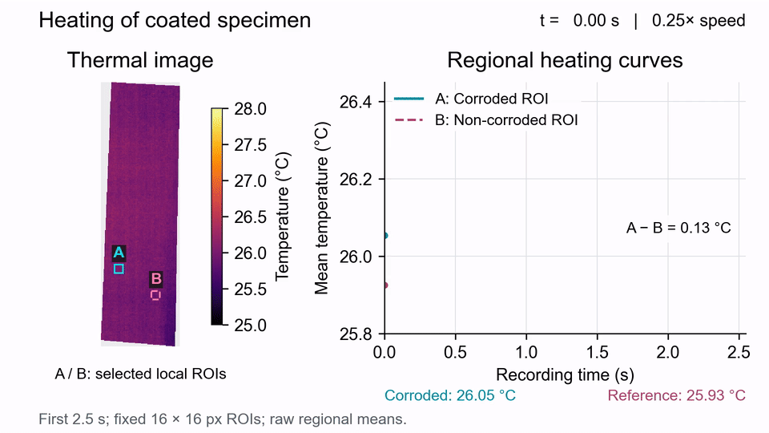
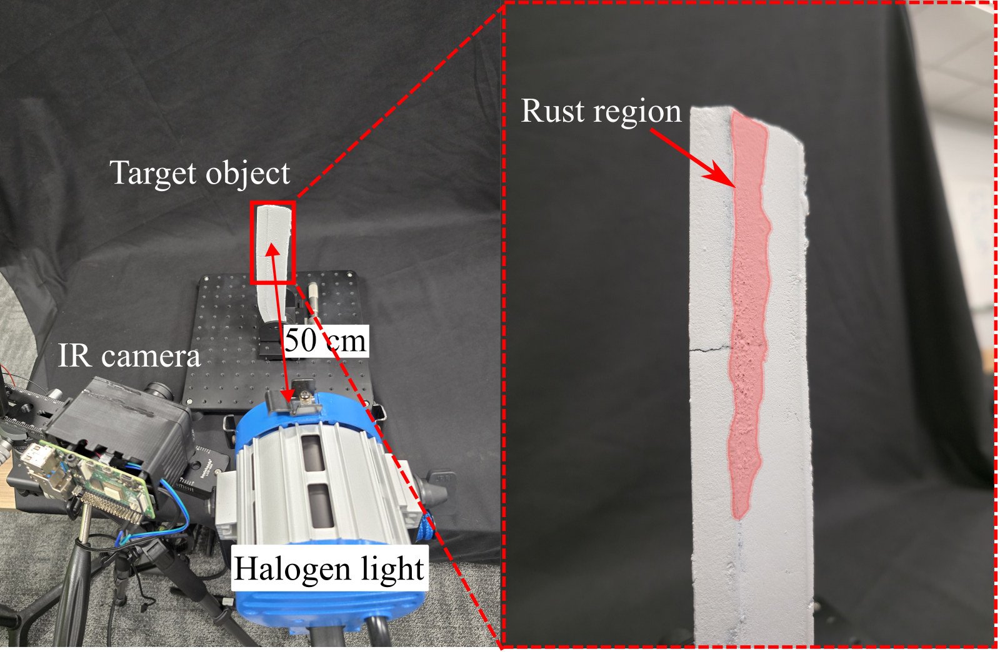

# Thermal Corrosion Detection

**Mapping under-coating corrosion through the evolution of surface temperature.**

Protective coatings can conceal the condition of the steel beneath them, making visual assessment of the underlying surface difficult. This project investigates how active infrared imaging can reveal spatial differences in the heating response of a coated specimen and support the identification of corrosion-affected regions.

The approach follows the temperature history at each image location during external heating. It describes the magnitude, rate, and timing of the local response, then brings these measurements together into spatial maps of thermal behavior. The resulting maps connect the recorded heating process with regions of interest on the specimen, providing a basis for interpreting where corrosion-related thermal differences occur.

This repository accompanies the experimental study below. It brings together the measurement example, response analysis, region mapping, and synchronized visualization so that readers can follow the evidence from thermal frames to temperature curves and spatial results.

**Related paper:** [Detection of Subsurface Corrosion Beneath Coatings Using Thermal Time-Series Analysis](https://doi.org/10.5006/C2026-00421)  
Qingyu Ren, Hui Wang, Sreelakshmi Sreeharan, and Alexander Chattos · AMPP Annual Conference + Expo 2026 · Paper C2026-00421

## Observe the heating response

[](assets/video/thermal-heating.mp4)

[Watch or download the MP4](assets/video/thermal-heating.mp4) · [Static preview](assets/images/heating-preview.png) · [Temperature data](data/regional_temperature_curves.csv)

The left panel shows the specimen warming over time. The right panel tracks the mean temperature of the two marked windows, making it possible to see how their responses separate as heating progresses. At the end of the displayed interval, region A is approximately **0.45 °C warmer** than region B.

The demonstration covers the first **2.5 seconds at 0.25× playback speed**. Both curves are calculated directly from fixed 16 × 16 pixel windows, without temporal smoothing. The thermal image and curves advance together, and their display ranges remain fixed throughout the video.

A and B follow the project's thermal region interpretation as corroded and non-corroded references. This is a selected local comparison; independent corrosion ground-truth annotations are not included in the repository.

## Experimental setup



A halogen lamp provides external heating while an infrared camera records the surface temperature of the coated steel specimen. Each pixel in the image sequence supplies a temperature–time history associated with a location on the specimen.

The analysis uses a cropped specimen image sequence, retaining the connection between image coordinates and measured temperatures. This allows a feature identified in a response map to be examined alongside its original thermal history. The setup photograph shows the camera and heating arrangement, together with the specimen detail used to explain the experiment.

## From thermal recordings to region maps

The workflow connects four stages:

1. **Record the transient response.** Read the temperature sequence while preserving frame order, temperature units, and the specimen coordinate system.
2. **Describe local heating behavior.** Estimate response descriptors at each valid pixel, including temperature amplitude, response rate, and transition timing. Retain fitting error as a separate measure of agreement with the recorded curve.
3. **Identify response patterns.** Compare pixels jointly in the response-descriptor space and group locations with similar thermal behavior. This stage operates without manually supplied training labels.
4. **Map and inspect the results.** Return the groups to their image locations and compare their spatial distribution with the feature maps, thermal sequence, and selected regional curves.

The research focus is the connection between the measured transient response and the spatial interpretation of a coated specimen. The shared data and visualizations make that connection inspectable at both the pixel and regional levels.

## Reading the response maps


These six panels show complementary aspects of the same recorded response. The amplitude and timing maps describe how local heating develops; the fitting-error map helps assess how well the response model describes the observations. The final panel shows the spatial organization of the response groups.

| Quantity | What the map describes | Unit |
|---|---|---|
| Amplitude A | Fitted temperature change between the lower and upper asymptotes | °C |
| Rate coefficient k | How rapidly the fitted transition develops | s⁻¹ |
| Inflection time t₀ | Time of the fitted maximum heating rate, relative to the fitting window | s |
| Lower asymptote B | Lower temperature level of the fitted response | °C |
| Fit RMSE | Difference between the fitted and processed temperature histories | °C |
| Region labels | Groups of pixels with similar combined response descriptors | — |

The displayed image is the existing experimental result with corrected parameter annotations. Its Rust/Normal labels retain the project's interpretation. Newly computed outputs use **cluster IDs 0 and 1**, leaving their physical interpretation explicit.

<details>
<summary><strong>Model formulation and implementation details</strong></summary>

The current implementation describes each pixel's temperature history with a four-parameter sigmoid response:

$$T(t)=B+\frac{A}{1+\exp[-k(t-t_0)]}.$$

A two-component Gaussian mixture model groups the fitted `(A, k, t₀)` descriptors without feature standardization. These model choices implement the response-analysis and grouping stages described above.

The maximum fitted temperature slope is `A × k / 4`; `k` alone has units of s⁻¹. `B` is the lower asymptote and need not equal the first measured temperature. The inherited upper bound for `k` is 5 s⁻¹, so values at this bound should be interpreted in the context of the fitting constraints.

Preprocessing, parameter bounds, missing-data handling, and the distinction between response groups and independently verified corrosion labels are documented in [reproduction details](docs/reproducibility.md).

</details>

## Run the example

Use Python 3.10 or newer in an activated environment:

```bash
python -m pip install -r requirements.txt
python scripts/sigmoid_gmm.py
```

The bundled real-data excerpt is sufficient to run the complete response-analysis and region-mapping workflow. Results are written to `outputs/sigmoid_gmm/`, including numerical parameter maps, region IDs, PNG/SVG figures, observation counts, and a run summary. Frame selection, denoising, fitting bounds, and worker count are editable near the top of the script.

To regenerate the synchronized animation, install [FFmpeg](https://ffmpeg.org/download.html), make both `ffmpeg` and `ffprobe` available on `PATH`, then run:

```bash
python scripts/thermal_heating_animation.py
```

The animation runs directly from the bundled recording and saved region definitions. It writes MP4, GIF, still images, and regional temperature data to `outputs/animation/`. The curated homepage assets remain available separately under `assets/`.

## Repository guide

| Location | Contents |
|---|---|
| [scripts/sigmoid_gmm.py](scripts/sigmoid_gmm.py) | Pixel-wise response analysis and thermal region mapping |
| [scripts/thermal_heating_animation.py](scripts/thermal_heating_animation.py) | Synchronized thermal frames and regional curves |
| [scripts/prepare_sample.py](scripts/prepare_sample.py) | Lossless frame extraction from a full NPZ recording |
| [data/README.md](data/README.md) | Data format, specimen coordinates, masks, and recording details |
| `assets/images/` and `assets/video/` | Setup photograph, response maps, and heating demonstration |
| [docs/reproducibility.md](docs/reproducibility.md) | Processing settings, provenance, and interpretation limits |

## Data and interpretation

- **Included measurements:** Original frames 0–150, shape `(151, 505, 151)`, stored as float32 temperatures in °C with lossless compression. The full 9,000-frame recording is not bundled; the full-record regional curves are included as CSV.
- **Analysis and display:** Response fitting uses source frames `[1:150]` with explicit per-frame spatial denoising. The animation uses raw frames `[0:151]`. The fitting and recording time origins therefore differ by one frame.
- **Timing and coordinates:** The configured analysis rate is 60 fps. Recording time zero is the first frame, not a verified heater-trigger timestamp. The animation windows begin at A `(26, 349)` and B `(97, 399)` in top-left `(x, y)` coordinates. The curve range is 25.80–26.45 °C.
- **Scope:** The example demonstrates thermal response differences on the supplied specimen. Region labels and selected local curves do not establish a general detection-accuracy figure or performance across other specimens and heating conditions.
- **Checks:** The packaged workflow has been run on the included example, with successful fits at 67,774 pixels and converged region grouping. Video decoding, curve consistency, and preservation of source assets were also checked; see the [validation record](docs/validation.json).

## Citation

Please cite the [AMPP paper](https://doi.org/10.5006/C2026-00421) when using this work. A BibTeX entry is available in [CITATION.bib](CITATION.bib).
