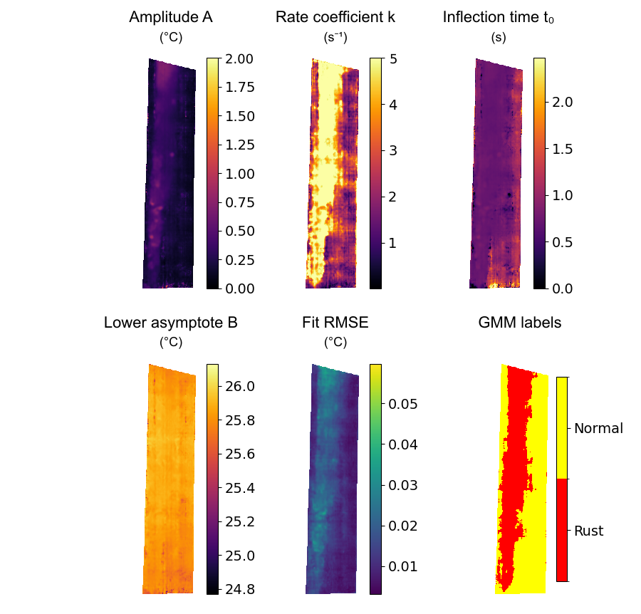

# Thermal Corrosion Detection

Active infrared thermography for mapping corrosion beneath protective coatings. This repository contains the sigmoid fitting and Gaussian mixture clustering workflow, a real thermal recording excerpt, and a synchronized heating demonstration.

**Related paper:** [Detection of Subsurface Corrosion Beneath Coatings Using Thermal Time-Series Analysis](https://doi.org/10.5006/C2026-00421)  
Qingyu Ren, Hui Wang, Sreelakshmi Sreeharan, and Alexander Chattos · AMPP Annual Conference + Expo 2026 · Paper C2026-00421

## Heating demonstration

[](assets/video/thermal-heating.mp4)

[Watch or download the MP4](assets/video/thermal-heating.mp4) · [Static preview](assets/images/heating-preview.png) · [Temperature data](data/regional_temperature_curves.csv)

The animation shows the first **2.5 seconds at 0.25× speed**. The two fixed 16 × 16 pixel windows are A at `(x=26, y=349)` and B at `(x=97, y=399)`, using top-left image coordinates. Curves are unfiltered spatial means; the temperature axis is 25.80–26.45 °C. The 1080p H.264 MP4 is approximately 1.1 MB.

A and B are selected thermal regions interpreted as corroded and non-corroded references. They illustrate a local response difference, not a whole-specimen average or independently verified ground truth.

## Experimental setup


The specimen is heated with a halogen lamp while an infrared camera records its surface temperature response.

## Thermal features and clustering



The temperature history at each pixel is fitted using:

$$T(t)=B+\frac{A}{1+\exp[-k(t-t_0)]}.$$

| Parameter | Meaning | Unit |
|---|---|---|
| A | Temperature amplitude | °C |
| k | Sigmoid rate coefficient | s⁻¹ |
| t₀ | Inflection time relative to the fitting window | s |
| B | Lower asymptotic temperature | °C |
| RMSE | Root-mean-square fitting error | °C |

A two-component GMM uses the fitted `(A, k, t₀)` values without feature standardization. The maximum sigmoid slope is `A × k / 4`; `k` alone is not a temperature slope. `B` need not equal the first measured temperature.

The image above is the existing project figure with corrected annotations. Newly computed GMM outputs use **cluster IDs 0 and 1**, because an unsupervised cluster ID does not establish corrosion status.

## Quick start

Use Python 3.10 or newer in an activated environment:

```bash
python -m pip install -r requirements.txt
python scripts/sigmoid_gmm.py
```

The included sample is sufficient for the complete fitting and clustering run. Results are written to `outputs/sigmoid_gmm/` as parameter arrays, PNG/SVG figures, and a run summary. Settings such as frame range, fit bounds, denoising, and worker count are editable near the top of the script.

To regenerate the animation, install [FFmpeg](https://ffmpeg.org/download.html), make both `ffmpeg` and `ffprobe` available on `PATH`, then run:

```bash
python scripts/thermal_heating_animation.py
```

This creates MP4, GIF, still images, and ROI temperature data under `outputs/animation/`. It does not require running the GMM first. Generated outputs do not overwrite the curated homepage assets.

## Repository contents

```text
scripts/
  sigmoid_gmm.py                Pixel-wise fitting and two-component GMM
  thermal_heating_animation.py  Synchronized thermal images and ROI curves
  prepare_sample.py             Lossless extraction from a full NPZ recording
data/
  early_heating.npz              151 original frames; float32 Celsius data
  roi_masks.npz                 Saved masks for the displayed specimen
  regional_temperature_curves.csv  Full 150-second ROI curves
  animation_metadata.json       Coordinates, timing, and source provenance
assets/
  images/                       Corrected setup and thermal feature figures
  video/                        Homepage GIF and GitHub-ready MP4
docs/                           Method details, provenance, and validation
```

## Reproduction notes

- **Data:** The example contains original source frames 0–150, shape `(151, 505, 151)`, with lossless compression. The complete 9,000-frame recording is not bundled. See [data details](data/README.md).
- **Fitting:** The paper workflow selects source frames `[1:150]`, resets fitting time to zero, and applies per-frame non-local means denoising. The animation uses raw frames `[0:151]` and no temporal smoothing.
- **Bounds:** The original upper bound for `k` is 5 s⁻¹. Values at this bound require care when interpreting parameter separation.
- **Timing:** 60 fps is the configured analysis rate. Recording time zero is the first frame, not a verified heater-trigger timestamp.
- **Validation:** See [reproduction details](docs/reproducibility.md) and [packaging checks](docs/validation.json).

## Citation

Please cite the [AMPP paper](https://doi.org/10.5006/C2026-00421) when using this work. A BibTeX entry is available in [CITATION.bib](CITATION.bib).
